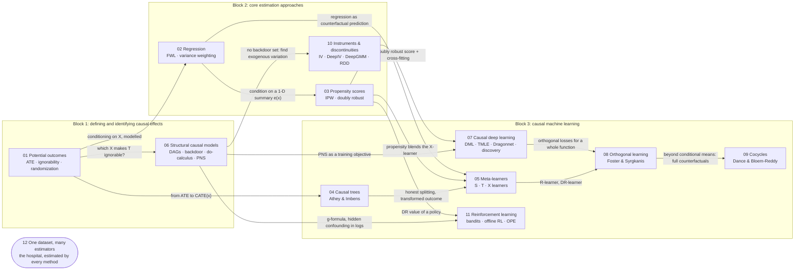

# Causal inference: a knowledge graph of CPSC 532Y

Notes and code for [CPSC 532Y: Causal Machine Learning](https://m-lecuyer.github.io/532Y-CausalInference/)
(UBC, Term 1 2025, Mathias Lécuyer). Every lecture and paper on the course schedule lives in exactly one topic folder.
Each folder has its own README with the readings, the key ideas, how the topic connects to the others, and any code
written for it.

## The graph

Click a node to open its folder. The edges are the conceptual links between topics, labelled with the idea that
carries over.



If the nodes are not clickable in your viewer (GitHub sometimes disables Mermaid links), use the table below.

## Topics and readings

| Dates | Topic folder | Readings | Code in this repo |
| --- | --- | --- | --- |
| Sep 3–15 | [01 Potential outcomes](01-potential-outcomes/) | lectures; Hernán & Robins, *Causal Inference: What If* | [`simpson/`](01-potential-outcomes/simpson/): Simpson's paradox, the bias decomposition, randomization, matching, conditioning, CIs |
| Sep 17–22 | [02 Regression](02-regression/) | lectures (FWL theorem) | in [12](12-one-dataset-many-estimators/) §2: OLS's variance weights made visible |
| Sep 22–24 | [03 Propensity scores](03-propensity-scores/) | lectures; Hernán & Robins §12.2; Morgan & Winship §7.3 | in [12](12-one-dataset-many-estimators/) and [08](08-orthogonal-learning/) |
| Sep 29 | [04 Causal trees](04-causal-trees/) | [Athey & Imbens 2016] Recursive partitioning for heterogeneous causal effects | [`causal-tree/`](04-causal-trees/causal-tree/): honest causal trees from scratch, CI coverage, adaptive vs honest |
| Oct 1 | [05 Meta-learners](05-meta-learners/) | [Künzel+ 2019] Metalearners for heterogeneous treatment effects | in [12](12-one-dataset-many-estimators/) §5 |
| Oct 6–22 | [06 Structural causal models](06-structural-causal-models/) | lectures; Pearl, *Causality* (Ch. 3, 7, 9) | [`dags/`](06-structural-causal-models/dags/): d-separation, backdoor sets, do-calculus rules, front door, PN/PS/PNS |
| Oct 27–29 | [07 Causal deep learning](07-causal-deep-learning/) | lectures: DML, TMLE, Dragonnet, deconfounder, causal representations, sensitivity, discovery | |
| Nov 3 | [08 Orthogonal learning](08-orthogonal-learning/) | [Foster & Syrgkanis 2023] Orthogonal statistical learning; [Chernozhukov+ 2018] DML | [`dml/`](08-orthogonal-learning/dml/): Neyman orthogonality measured, cross-fitting, R-learner |
| Nov 5–17 | [09 Cocycles](09-cocycles/) | [Dance & Bloem-Reddy 2024] Causal inference with cocycles | |
| Nov 19 | [10 Instruments & discontinuities](10-instruments-and-discontinuities/) | [Hartford+ 2017] Deep IV · [Bennett+ 2019] Deep GMM · RDD lecture | [`iv-rdd/`](10-instruments-and-discontinuities/iv-rdd/): 2SLS and sieve IV on hotel pricing, RDD with CV bandwidth |
| Nov 24 | [11 Reinforcement learning](11-reinforcement-learning/) | lecture: bandits, contextual bandits, off-policy RL; further reading on offline RL | [`offline-rl/`](11-reinforcement-learning/offline-rl/): offline RL as causal inference. Off-policy evaluation (IS = IPW, model-based = g-formula, DR = AIPW), pessimistic policy learning, hidden confounding |
| all | [12 One dataset, many estimators](12-one-dataset-many-estimators/) | cross-topic: the hospital example with nonlinear confounding, estimated with the methods of 01–08 | [`notebooks/`](12-one-dataset-many-estimators/notebooks/one_dataset_many_estimators.ipynb): 14 ATE estimators and 7 CATE estimators compared |

Project presentations (Nov 26–Dec 3) and assignments are not part of the graph.

## The thread through the course: where does identification come from?

Every method answers two questions. *Why is the effect identified?* (which assumption lets an observable quantity
stand in for a counterfactual one) and *how is it estimated?* (what is modelled, and with what).

- **Randomization** (01): treatment is independent of potential outcomes by design. The difference in means works.
- **Conditional ignorability** (01, 02, 03, 04, 05, 07, 08): treatment is as good as random *given X*. Everything
  else is estimation: stratify (01), model the outcome (02, 05), model the propensity (03), or both with an
  orthogonal score (07, 08); for heterogeneous effects, partition (04) or learn $\tau(x)$ directly (05, 08).
- **A graph** (06): says *which* X makes treatment ignorable (backdoor), or identifies the effect without any
  adjustment set (front door). It also separates what observations, experiments and counterfactuals can answer.
- **Exogenous variation in part of the treatment** (10): an instrument, or a threshold rule. No ignorability, but
  exclusion or continuity instead, and the answer is local.
- **Structure on the counterfactual map itself** (09): cocycles model how an outcome transforms when the treatment
  changes, which reaches individual-level counterfactuals under extra assumptions.
- **Sequential decisions** (11): offline RL learns a policy from logs, and the value of a policy is a potential outcome
  under a treatment regime. Importance sampling is IPW, model-based evaluation is the g-formula, doubly robust OPE is
  AIPW, and the same two assumptions (no hidden confounders, positivity) are needed at every step.

[12 One dataset, many estimators](12-one-dataset-many-estimators/) makes this concrete: one hospital (drug vs surgery,
confounded by severity and age, with three irrelevant covariates) and every estimator from 01–08 on the same data, with
the truth known.

## The running example

The course's running example is used throughout: a hospital chooses between a **drug** ($T=0$) and **surgery**
($T=1$); sicker patients do worse and are more often operated on, and surgery helps severe patients but slightly harms
mild ones. Pooled, surgery looks worse; within every severity group it is better on average (Simpson's paradox). The
simulator ([`hospital.py`](12-one-dataset-many-estimators/src/hospital.py)) knows both potential outcomes of every
patient, so every estimate can be checked against the truth. The instrumental-variable notebook uses the course's other
example, a hotel setting prices under unobserved demand.

## Layout

```
.
├── 01-potential-outcomes/
│   └── simpson/                          code
├── 02-regression/
├── 03-propensity-scores/
├── 04-causal-trees/
│   └── causal-tree/                      code
├── 05-meta-learners/
├── 06-structural-causal-models/
│   └── dags/                             code
├── 07-causal-deep-learning/
├── 08-orthogonal-learning/
│   └── dml/                              code
├── 09-cocycles/
├── 10-instruments-and-discontinuities/
│   └── iv-rdd/                           code
├── 11-reinforcement-learning/
│   └── offline-rl/                       code
└── 12-one-dataset-many-estimators/       code (cross-topic)
```

Code folders follow the same conventions: plain NumPy with no ML framework (the "nuisance models" are a few dozen
lines of kernel ridge and logistic regression in `learners.py`), a `src/` package, a `requirements.txt`, and executed
notebooks whose outputs render on GitHub. Each folder is self-contained, so the simulator is copied where needed. New
code for a topic goes inside that topic's folder; work that compares several topics goes in a cross-topic folder like
`12-one-dataset-many-estimators/`.
